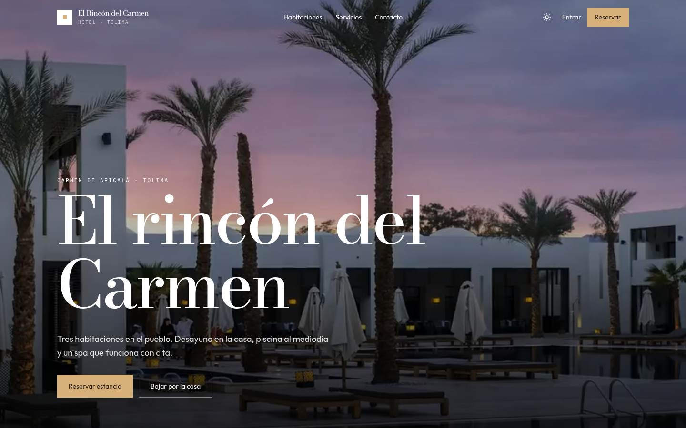
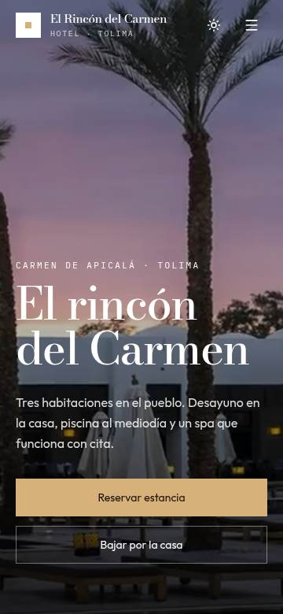
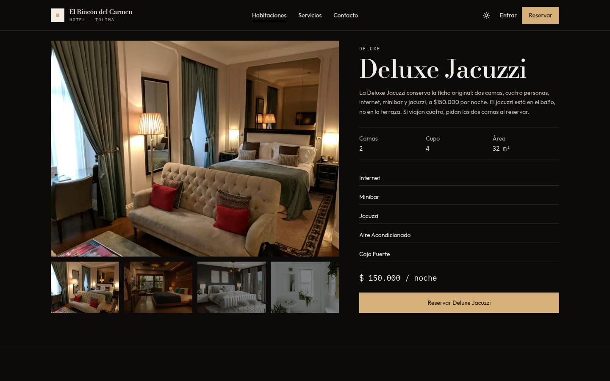
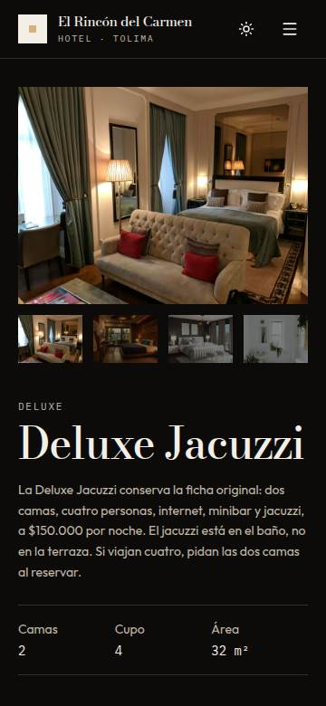
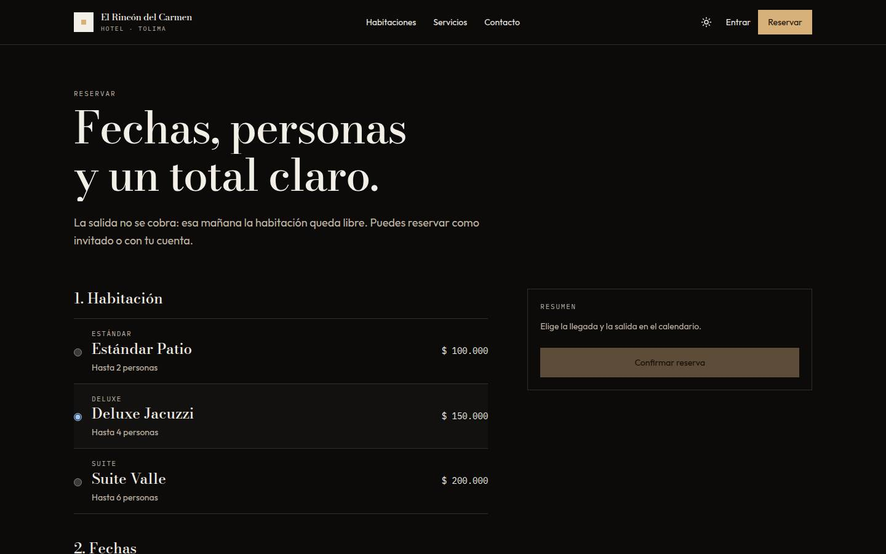
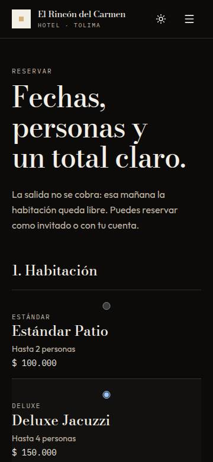
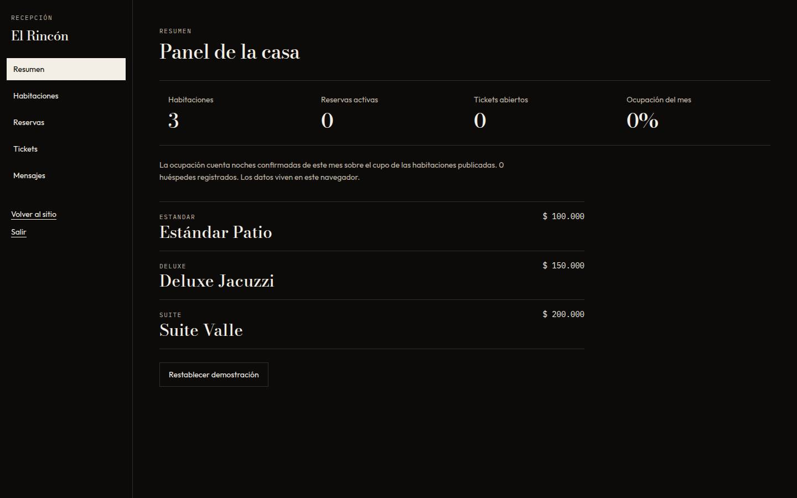
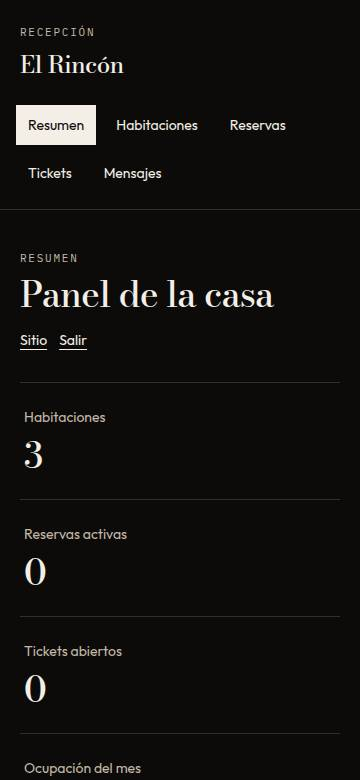

# Hotel El Rincón del Carmen

Sitio del hotel en Carmen de Apicalá, Tolima: tres habitaciones, reserva con fechas y tarifa, cuenta de huésped, quejas y reclamos, contacto y un panel de recepción. Es un proyecto de práctica. No cobra y no habla con un backend de producción.

La versión anterior era una SPA de web components que guardaba todo en `localStorage`. Esta conserva el dominio —estándar, deluxe y suite; spa, gastronomía y piscina; reservas, usuarios, tickets y administración— y lo presenta como un sitio de hospitalidad.

## Capturas

Inicio, 1440 px.



Inicio, 360 px.



Ficha de habitación, 1440 px y 360 px.





Reserva, con el rango marcado y el total calculado.





Recepción.





El resto de las vistas, en 1440 px y 360 px, está en `docs/screenshots/`: habitaciones, entrar, registro, cuenta, soporte y contacto. El recorrido del héroe y el cambio de página está en [docs/recorrido.mp4](docs/recorrido.mp4).

## Stack

React 19, TypeScript y Vite. El resultado es un sitio estático: `npm run build` deja `dist/` listo para Netlify o Vercel, sin servidor Node en producción. Next.js aportaría enrutado de servidor que esta demo no necesita; el dato vive en el navegador o, si se quiere, en un json-server local.

- Tailwind CSS 4 para el sistema visual.
- Primitivas de Radix (diálogo, acordeón, slot) compuestas aquí, al modo de shadcn, con los tokens del hotel y sin el tema índigo de fábrica.
- Motion para el héroe, las máscaras y las transiciones de ruta. GSAP ScrollTrigger para la sección fijada de habitaciones. Lenis para el desplazamiento. Embla para los carruseles. No hay escena WebGL: el peso se queda en el video y en el scroll.
- React Hook Form y Zod en reserva, cuenta, contacto y tickets.
- Vitest y Testing Library para la tarifa, el solape de fechas y el resumen de precio.

La capa de datos está en `src/lib/api`. `HotelRepository` es la interfaz. Hoy hay dos implementaciones:

- `local`, la predeterminada. Semilla en `src/lib/api/seed.ts`, persistencia en `localStorage` (`rdc.v1`). Funciona al abrir el build estático.
- `http`. json-server sobre `db.json`. Misma interfaz, para ensayar el cambio a un backend real (por ejemplo Supabase) sin tocar las pantallas.

## Qué quedó del proyecto anterior

| Antes | Ahora |
| --- | --- |
| Inicio con carrusel, gastronomía, spa y piscina | Inicio con video, índice de habitaciones, servicios, amenidades, reseñas de ejemplo, mapa y preguntas |
| Listado y ficha de habitación | `/habitaciones` y `/habitaciones/:slug`, con galería |
| Reserva con solape de fechas y total por noches | `/reservar/:slug`, calendario de rango, huéspedes y resumen |
| Registro e inicio de sesión, también de recepción | `/entrar` |
| Reservas del huésped | `/cuenta` |
| Quejas y reclamos atados a una reserva | `/soporte` |
| Contacto | `/contacto`, con mensaje guardado en la demo |
| Administración de habitaciones, reservas y tickets | `/admin` |

La ficha original se conserva en las tres habitaciones: Estándar Patio (1 cama, 2 personas, $100.000), Deluxe Jacuzzi (2 camas, 4 personas, $150.000, internet, minibar y jacuzzi) y Suite Valle (3 camas, 6 personas, $200.000). La suite decía «vista al mar»; el hotel está en el valle, así que el servicio publicado es «vista al jardín».

La salida no ocupa la noche siguiente. Si una reserva termina el día 5, otra puede empezar ese mismo día. Las canceladas no bloquean. El total lo calcula el almacén (`noches × tarifa`), no el formulario.

Se puede reservar como invitado. Si después te registras con el mismo correo, la reserva aparece en la cuenta. Un ticket solo se crea sobre una reserva tuya y solo se borra mientras está en Pendiente.

## Cómo ejecutarlo

Hace falta Node 22.

```bash
npm install
npm run dev
```

Abre http://127.0.0.1:5173.

Recepción de demostración: usuario `admin`, contraseña `admin123`.

Otros comandos:

```bash
npm test
npm run lint
npm run build
npm run preview
```

### API local opcional

```bash
npm run dev:api
```

Eso levanta json-server en el puerto 3001 y Vite. En `.env`:

```bash
VITE_DATA_SOURCE=http
VITE_API_URL=http://127.0.0.1:3001
```

Hay un ejemplo en `.env.example`. Sin ese archivo, la app no llama a ningún servidor.

En recepción, «Restablecer demostración» vuelve a las tres habitaciones y borra reservas, usuarios, tickets y mensajes del almacén activo.

Las contraseñas se guardan en claro. Sirve para inspeccionar el flujo en un proyecto de práctica. No sirve para un hotel real.

## Despliegue

El build es estático. `netlify.toml` publica `dist` y reescribe las rutas a `index.html`. En Netlify: repositorio, comando `npm run build`, directorio `dist`. El archivo ya fija Node 22.

En Vercel el proyecto se detecta como Vite. `vercel.json` repite la reescritura de la SPA. No hace falta configuración extra si el directorio de salida es `dist`.

La demo anterior estaba en Netlify. Esta versión se despliega igual, como sitio estático.

## Estructura

```
src/
  components/     layout, foto, resumen de precio, primitivas
  features/       inicio, habitaciones, reserva, cuenta, soporte, contacto, recepción
  lib/api/        interfaz, semilla, almacén local y cliente http
  lib/booking.ts  noches, tarifa, solape y ocupación
  data/content.ts textos de servicios, preguntas y amenidades
public/media/     AVIF, WebP y el video del héroe
```

Las fuentes de las fotos están en [CREDITS.md](CREDITS.md).

## Autor

Santiago Gallo.
